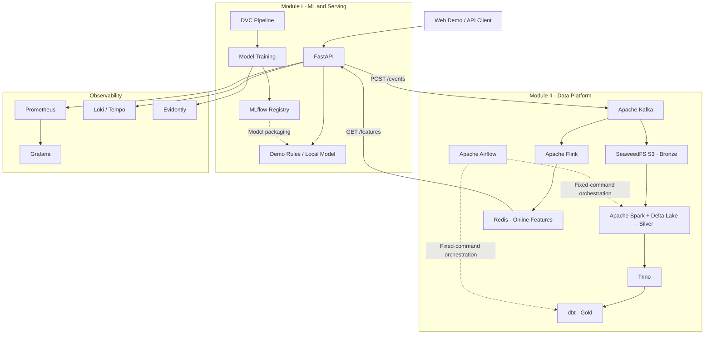
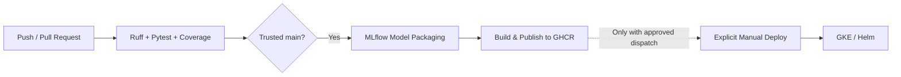

# CogniFlow

### An end-to-end ML systems platform for cognitive load and focus analytics

[](https://github.com/nhatminh06/personal-cognitive-load-monitor/actions/workflows/ci-cd.yaml)
[](LICENSE)


**CogniFlow** is a local-first data engineering and MLOps platform that explores cognitive load using focus time, distraction patterns, task pressure, and deadlines.

The project combines model development, real-time event processing, lakehouse analytics, reproducible experiments, containerized services, observability, and infrastructure-as-code.

It is designed to demonstrate how independently developed data and machine learning components can operate as one integrated system, with explicit security boundaries and verifiable behavior.

> **Disclaimer:** CogniFlow is an educational ML systems project, not a medical or psychological diagnostic tool. Its current labels are `synthetic_proxy` labels, not clinically validated measurements of cognitive load.

---

## Project Status

**Last verified: October 26, 2026**

| Component | Status |
|---|---|
| Module I: MLOps Foundation | Implemented and locally validated |
| Module II: Data Engineering & Streaming | Implemented and locally validated |
| Security hardening, PR #6 | Merged |
| Module III Phase 1: Historical feature contracts | Implemented and locally validated |
| Module III Phase 2: Reproducible training and registry | Implemented and locally validated |
| Module III Phase 3: Secure local model serving | Deployment machinery implemented; live rollout awaits an approved model |
| Later Module III serving/orchestration | Planned |
| Local Docker and data pipelines | Runtime tested |
| Helm and local Terraform/kind | Runtime validated |
| GKE Terraform | Statically validated only |
| GKE / production KServe | Not deployed |
| 100 GB performance benchmark | Not performed |

### Verification highlights

- **138 Python tests passed**, with **89.56% combined coverage** against an 81% enforcement threshold.
- Four Jupyter notebooks executed successfully.
- DVC pipeline stages reproduced or validated as up to date.
- Spark/Delta/S3A, Trino and dbt integration tested using real local services.
- Airflow 3 completed its six-task orchestration DAG.
- Kafka/Flink/Redis streaming and cross-language feature parity were verified.
- GitHub Actions runs tests before trusted-branch image publication.
- No GCP resources or paid cloud deployment were required for the reported local results.

See [Module II test evidence](docs/module2/testing.md) and [security verification](docs/security-audit/verification.md) for the detailed scope and results.

Module III Phase 1 adds a version-pinned, point-in-time historical feature contract over Delta Silver without deploying new ML infrastructure. See the [historical features guide](docs/module3/phase1-historical-features.md).

Phase 2 adds chronological synthetic-proxy model comparison, lineage manifests, explicit MLflow candidate registration, and a separate approval boundary. See the [Phase 2 training guide](docs/module3/phase2-ml-training.md).

Phase 3 adds approval-bound MLflow artifact packaging, verified local `skops` loading, and an isolated kind/Helm serving path. The current candidate remains undeployed. See the [Phase 3 serving guide](docs/module3/phase3-model-serving.md).

---

## Why CogniFlow?

Building a machine learning model is only one part of an ML system. A usable platform also needs reliable data ingestion, consistent features, reproducible experiments, model packaging, deployment controls, and monitoring.

CogniFlow explores these engineering concerns through a behavioral analytics use case.

The project is organized around four goals:

1. **Reproducibility:** Track data transformations, experiments, model versions, and build artifacts.
2. **Data consistency:** Apply versioned contracts and verify equivalent feature calculations across Python, Spark, and Flink.
3. **Reliability:** Support durable ingestion, idempotent processing, bounded retries, explicit failure propagation, and freshness-aware online features.
4. **Security:** Use authenticated interfaces, least-privilege services, immutable deployment artifacts, and documented release gates.

## System Architecture



Module I's synchronous prediction endpoint does not depend on Kafka. Module II extends the platform with asynchronous data processing while preserving the existing inference contract.

The diagram represents the verified local architecture and configured integrations. Cloud deployment remains a separate, unverified runtime target.

---

## Technology Stack

| Layer | Technologies | Responsibility |
|---|---|---|
| Application | Python, FastAPI, Pydantic | HTTP APIs, validation, inference |
| Machine learning | scikit-learn, MLflow | Training, evaluation, model registry |
| Reproducibility | DVC, Jupyter, uv | Data and dependency reproducibility |
| Messaging | Apache Kafka 3.9.2 | Versioned asynchronous events |
| Object storage | SeaweedFS 4.50 | S3-compatible Bronze and lakehouse storage |
| Batch processing | Spark 3.5.5, Delta Lake 3.3.2 | Feature processing and ACID tables |
| SQL analytics | Trino 478, dbt Core 1.11.14 | Querying and incremental Gold models |
| Streaming | Flink 1.20.5 | Event-time windows and stateful aggregation |
| Online features | Redis 7.4 | Freshness-aware feature retrieval |
| Orchestration | Airflow 3.3.2 | Local fixed-command batch workflows |
| Observability | Prometheus, Grafana, Loki, Tempo, Evidently | Metrics, dashboards, logs, tracing, drift |
| Infrastructure | Docker Compose, Helm, Terraform | Local environments and cloud deployment definitions |
| CI/CD | GitHub Actions, GHCR | Automated tests and immutable image publication |

---

## Local Kubernetes Deployment (No Cloud Required)

CogniFlow can run in a one-node kind cluster managed by Terraform and Helm. The local path uses only Docker resources on the current machine; it does not use the GKE Terraform configuration, cloud credentials, KServe, ingress, or Spark.

`Terraform → kind (one local node) → Helm → ClusterIP → FastAPI`; access is through a loopback-only kubectl port-forward. Allow roughly 1 GiB RAM for the verified cluster, plus temporary headroom for image builds.

```fish
mkdir -p infra/terraform/local/.kube
terraform -chdir=infra/terraform/local/cluster init
terraform -chdir=infra/terraform/local/cluster apply
docker build -t cognitive-load-api:local .
kind load docker-image cognitive-load-api:local --name cogniflow-local
terraform -chdir=infra/terraform/local/app init
terraform -chdir=infra/terraform/local/app apply
kubectl --kubeconfig infra/terraform/local/.kube/cogniflow-local.yaml \
  --context kind-cogniflow-local -n cognitive-load \
  port-forward service/cognitive-load-monitor 18000:80 --address 127.0.0.1
```

Then open http://127.0.0.1:18000. Host port 8000 remains reserved for PersonalOS; CogniFlow still uses Kubernetes Service port 80 and container port 8000 internally. See the [local Kubernetes guide](docs/deployment/local-kubernetes.md) for prerequisites, verification, upgrades, and safe teardown.

---

## Module I: Reproducible MLOps Foundation

Module I establishes the application, experiment, and model lifecycle.

### Model development

The model workflow includes exploratory analysis, data preparation, training, evaluation, and deployment preparation.

Four notebooks document these stages:

| Notebook | Purpose |
|---|---|
| `01_eda.ipynb` | Data exploration and visualization |
| `02_data_processing.ipynb` | Data cleaning, feature engineering, splitting |
| `03_model_training.ipynb` | Model training and evaluation |
| `04_prepare_for_deployment.ipynb` | Export and deployment preparation |

DVC tracks reproducible pipeline stages. MLflow records experiments and provides model registration and retrieval.

The implementation uses synthetic proxy labels. Reported model predictions should not be interpreted as validated psychological assessments.

### Inference API

FastAPI exposes a stable prediction contract with three explicit modes:

| Mode | Behavior |
|---|---|
| `demo_rule` | Deterministic rule-based demonstration |
| `local_model` | Runs the configured packaged model |
| `kserve` | Calls a configured external model-serving endpoint |

A missing or invalid model does not silently fall back to another backend.

The main endpoints are:

| Endpoint | Description |
|---|---|
| `GET /` | Lightweight local web demonstration |
| `GET /health` | Liveness check |
| `GET /ready` | Inference readiness check |
| `POST /predict` | Cognitive-load prediction |
| `GET /model-info` | Model mode, version and label provenance |
| `POST /events` | Validated session-event ingestion |
| `GET /features/{session_id}` | Current online features |
| `GET /metrics` | Prometheus metrics |

Production-sensitive API endpoints require an API key; a missing or invalid configuration fails closed.

---

## Module II: Data Engineering and Real-Time Processing

Module II extends CogniFlow with a local lakehouse and streaming pipeline.

### Batch processing: Bronze → Silver → Gold

```text
Validated Events
      |
      v
    Kafka
      |
      v
SeaweedFS S3
   BRONZE
      |
      v
Spark + Delta Lake
   SILVER
      |
      v
Trino + dbt
    GOLD
```

**Bronze:** Stores event payloads and ingestion metadata, including offsets and checksums, in S3-compatible object storage.

**Silver:** Uses Spark and Delta Lake for validated transformations, table history, transactional writes, and idempotent replays.

**Gold:** Uses Trino and dbt for analytical tables, including incremental models.

The local implementation has been tested through real Delta writes, MERGE operations, table reopen, SQL queries, and repeated dbt builds.

### Real-time streaming

```text
Kafka Session Events
        |
        v
 Apache Flink
        |
        +--> Event-time aggregation
        +--> Watermarks and lateness
        +--> Duplicate suppression
        +--> Stateful feature computation
        |
        v
      Redis
        |
        v
GET /features/{session_id}
```

Flink computes focus and distraction aggregates using event-time semantics. Redis provides a freshness-protected online projection, not the system of record.

The streaming implementation includes versioned event validation, bounded processing behavior, checkpoint/recovery support, late-event handling, and protections against stale Redis writes.

### Cross-language feature consistency

A shared test fixture verifies that feature calculations agree across Python, Spark and Flink.

This helps prevent training/serving inconsistency caused by differing schemas, feature orders, units, or timestamp semantics.

See [`tests/fixtures/feature_vectors.json`](tests/fixtures/feature_vectors.json) and [Module II verification](docs/module2/testing.md).

### Local orchestration

Airflow uses a six-task development DAG with authenticated, fixed-command Spark and dbt runners.

The design deliberately excludes Docker socket access and arbitrary caller-supplied shell commands.

---

## Getting Started

### Prerequisites

For the Python API:

- Python 3.11+
- [uv](https://docs.astral.sh/uv/)
- Git

For the data platform:

- Docker with the Compose plugin
- Enough local CPU, RAM and disk space for the selected profiles

For optional infrastructure validation:

- Helm
- Terraform

Local workflows do not require a Google Cloud account.

### 1. Clone the repository

```bash
git clone https://github.com/nhatminh06/personal-cognitive-load-monitor.git
cd personal-cognitive-load-monitor
```

### 2. Install Python dependencies

```bash
uv sync --frozen --all-extras
```

The project uses `uv.lock` to reproduce its Python environment.

### 3. Start the API

```bash
uv run uvicorn \
  --app-dir src \
  preprocessing_api.main:app \
  --host 127.0.0.1 \
  --port 8000
```

Open:

- Local UI: http://127.0.0.1:8000/
- API documentation: http://127.0.0.1:8000/docs
- Health: http://127.0.0.1:8000/health

These are local development endpoints. API documentation is disabled in production mode.

### 4. Send a prediction request

```bash
curl -X POST http://127.0.0.1:8000/predict \
  -H "Content-Type: application/json" \
  -d '{
    "focus_minutes": 120,
    "distraction_minutes": 30,
    "tasks_due": 3,
    "hours_to_deadline": 24
  }'
```

Example response in `demo_rule` mode:

```json
{
  "cognitive_load_level": "MEDIUM",
  "inference_source": "demo_rule",
  "model_version": null,
  "feature_as_of": null,
  "is_fallback": false
}
```

The response explicitly identifies its inference source rather than representing a rule-based result as a trained-model prediction.

### 5. Run the test suite

```bash
uv run ruff check src scripts jobs dags
make test
```

The CI coverage threshold is enforced with `--cov-fail-under=81`.

### 6. Reproduce the ML pipeline

```bash
uv run --extra dev dvc repro
```

Train and register a model:

```bash
uv run --extra dev python scripts/train_model.py \
  --input data/raw/sample_data.csv \
  --output models/cognitive_load_model.joblib
```

The model lifecycle and four notebooks are documented in the Module I materials under [`docs/module1/`](docs/module1/).

---

## Running Module II Locally

The local data platform is divided into Compose profiles so that heavyweight services do not all need to run simultaneously.

### Configure local credentials

```bash
cp .env.module2.example .env.module2
```

Edit `.env.module2` and replace the example storage and Redis passwords before starting the corresponding services.

This ignored file is for local development. Never commit secrets or reuse its example credentials for shared or remote systems.

### Start the ingestion layer

```bash
docker compose \
  --env-file .env.module2 \
  -f infra/module2/docker-compose.yml \
  --profile ingestion up -d
```

### Start local object storage

```bash
docker compose \
  --env-file .env.module2 \
  -f infra/module2/docker-compose.yml \
  --profile lake up -d
```

The S3 gateway is available on `127.0.0.1:9000`. Internally, SeaweedFS master, filer, and volume APIs are isolated from ordinary application workloads.

### Start the streaming pipeline

```bash
docker compose \
  --env-file .env.module2 \
  -f infra/module2/docker-compose.yml \
  --profile ingestion \
  --profile streaming up -d
```

### Stop the services

```bash
docker compose \
  --env-file .env.module2 \
  -f infra/module2/docker-compose.yml \
  --profile ingestion \
  --profile streaming stop
```

Stopping services preserves named Docker volumes.

**Spark batch profile restrictions:** Spark is subject to an approved, time-limited local-development security exception. Before activating the `batch` profile, follow the mandatory Ivy artifact verification, runner-token and isolation procedures in the [SEC-022 exception document](docs/security-audit/sec-022-development-exception-proposal.md). Do not run arbitrary Spark jobs or process untrusted datasets with this runtime.

For the complete sequential batch/streaming walkthrough, see [Module II demo script](docs/module2/demo-script.md).

---

## Docker and Infrastructure

### Build the FastAPI container

```bash
docker build -t cognitive-load-api:local .
```

Run it locally:

```bash
docker run --rm -p 127.0.0.1:8000:8000 cognitive-load-api:local
```

The API image runs under a non-root application user.

### Validate Kubernetes manifests

```bash
helm lint ./helm/cognitive-load-monitor
```

Render a local configuration without deploying it:

```bash
helm template cognitive-load-monitor \
  ./helm/cognitive-load-monitor \
  --namespace cognitive-load \
  -f helm/cognitive-load-monitor/values.local.yaml
```

The repository also includes Helm templates for KServe, ingress, HPA, monitoring and network policies, plus Terraform configuration for GKE.

**These files are deployment definitions, not evidence of a functioning production Kubernetes platform.** Live GKE/KServe integration, workload identity, network policy enforcement, TLS, managed secrets and cloud operational behavior remain deployment-time requirements.

Provisioning GKE may incur cloud charges. No cloud deployment is required to reproduce the documented local results.

---

## Observability

CogniFlow includes application and data-platform observability components:

| Component | Purpose |
|---|---|
| Prometheus | Metrics collection |
| Grafana | Dashboards and visualization |
| Loki | Centralized logs |
| Tempo | Distributed tracing |
| OpenTelemetry | Application instrumentation |
| Evidently | Data drift analysis |

The FastAPI application exposes `/metrics`, and the repository contains local observability configuration under [`infra/observability/`](infra/observability/).

Generate an Evidently drift report after preparing the relevant data:

```bash
uv run --extra dev python scripts/generate_drift_report.py \
  --reference data/processed/train.csv \
  --current data/processed/test.csv \
  --output reports/evidently/data_drift.html
```

Observability runtime verification is documented separately from production monitoring availability.

---

## CI/CD and Release Integrity

The workflow is defined in [`.github/workflows/ci-cd.yaml`](.github/workflows/ci-cd.yaml).



The workflow:

- Runs tests for pull requests and configured pushes.
- Enforces the 81% minimum coverage threshold.
- Restricts image publication to trusted `main` events.
- Trains, registers, and retrieves a model through an ephemeral CI MLflow server before packaging.
- Tags release images using the full commit SHA.
- Captures the published registry digest for immutable Helm deployment.
- Limits cloud deployment to an explicit manual workflow on `main`, subject to environment controls.
- Does not run a GKE deployment merely because a pull request was merged.

See the [workflow history](https://github.com/nhatminh06/personal-cognitive-load-monitor/actions).

---

## Security Model

Security is treated as part of the implementation and release process rather than a separate checklist.

Implemented controls include:

- Fail-closed production API-key authentication.
- Constant-time credential comparison.
- Request-size limits and security response headers.
- SHA-256 verification before local model deserialization.
- Protected CI credentials and restricted publication permissions.
- Digest-addressed deployment images.
- Non-root containers and resource limits where applicable.
- Authenticated, fixed-command batch orchestration.
- Segregated SeaweedFS storage control-plane access.
- No Docker socket access in Airflow.
- Offline, checksum-verified Spark runtime dependencies.

### SEC-022: Development-only accepted risk

The local Spark 3.5.5 runtime contains known, unresolved vulnerabilities.

Its recorded exact-image scan found:

| Finding | Count |
|---|---:|
| High | 121 |
| Critical | 5 |
| Total High/Critical occurrences | 126 |
| Distinct advisory IDs | 107 |
| Occurrences with scanner-reported fixes | 122 |
| Occurrences without scanner-reported fixes | 4 |

The Ubuntu 20.04 base is end-of-support. Compensating controls reduce exposure but do not patch these vulnerabilities.

The repository owner approved a limited exception on October 25, 2026, expiring **January 23, 2027**, with required periodic reviews.

The exception allows only the audited local Spark workflow with trusted synthetic data, authenticated fixed commands, isolated networks, non-root execution, read-only filesystems and checksum-verified offline dependencies.

It does **not** authorize the vulnerable Spark runtime for production, staging, Kubernetes, GKE, public exposure, cloud credentials, untrusted data or arbitrary workloads.

The exception is automatically revoked if mandatory controls fail or its review/expiry conditions are not satisfied.

See:

- [SEC-022 exception and mandatory controls](docs/security-audit/sec-022-development-exception-proposal.md)
- [Recorded owner decision](docs/security-audit/sec-022-owner-decision-packet.md)
- [Security findings](docs/security-audit/findings.md)
- [Release readiness](docs/security-audit/publication-readiness.md)

### Outstanding cloud security requirements

Before a production deployment, the project still requires real-cluster validation of Kubernetes NetworkPolicy, KServe model artifact verification, cloud IAM, managed secrets, TLS, ingress rate limiting, and workload-level security.

The development-only exception cannot be transferred to production.

---

## Validation and Reproducibility

The most recent local release validation reported:

| Verification | Result |
|---|---|
| Python regression suite | 138 passed |
| Combined test coverage | 89.56% |
| Ruff / MyPy | Passed |
| DVC pipeline | Up to date |
| Four Jupyter notebooks | Executed in prior validated runs |
| Spark + Delta + S3A | Passed |
| Delta reopen and replay | Passed |
| Trino query | Passed |
| dbt Gold build | 15/15 |
| Airflow orchestration | Six-task DAG passed |
| Spark isolation negative tests | Passed |
| Flink Java tests | Passed in prior validated runs |
| Docker Compose / Helm | Validated |
| Focused secrets verification | Passed |

These results describe specific local runs and checks. They are not claims about sustained production load, large-scale capacity, or cloud deployment reliability.

The 100 GB benchmark remains deferred.

---

## Repository Structure

```text
personal-cognitive-load-monitor/
├── .github/workflows/       # CI/CD automation
├── analytics/               # dbt models and Trino configurations
├── dags/                    # Airflow DAGs
├── data/                    # Example and processed data
├── docs/
│   ├── module1/             # MLOps documentation
│   ├── module2/             # Data platform documentation
│   └── security-audit/      # Findings, evidence and exceptions
├── helm/                    # Kubernetes Helm chart
├── infra/
│   ├── module2/             # Local data platform services
│   ├── observability/       # Monitoring configurations
│   └── terraform/           # GKE infrastructure definitions
├── jobs/                    # Spark jobs and fixed-command runners
├── kserve/                  # KServe configuration examples
├── models/                  # Model artifacts
├── notebooks/               # Four experiment notebooks
├── scripts/                 # Training and utility scripts
├── src/
│   ├── cogniflow_data/      # Data ingestion and online features
│   ├── preprocessing_api/   # FastAPI and inference
│   └── tests/               # Python tests
├── tests/fixtures/          # Cross-language reference fixtures
├── Dockerfile
├── Makefile
├── dvc.yaml
├── pyproject.toml
└── uv.lock
```

---

## Roadmap

### Completed

**Module I — MLOps Foundation**

Experimentation, DVC, MLflow, model training, FastAPI inference, container packaging, CI/CD and observability foundations.

**Module II — Data Engineering**

Kafka ingestion, SeaweedFS Bronze storage, Spark/Delta Silver processing, Trino/dbt Gold transformations, Flink event-time processing, Redis online features, Airflow orchestration, cross-language parity and security hardening.

### In progress: Module III — ML Platform Integration

Phases 1 and 2 now provide historical feature contracts and reproducible local training with candidate-only MLflow registration. Serving and orchestration remain planned.

Planned work includes:

- A sufficiently labeled, retained, version-pinned real Delta training snapshot.
- Offline/online feature consistency and freshness validation.
- Automated ML pipelines with reproducible dataset, code and image lineage.
- MLflow model promotion and artifact verification.
- KServe serving integration and runtime validation.
- Event-driven workflows with Knative Eventing.
- Operational SLOs for feature freshness, processing latency and inference availability.

The Module III plan is a design target, not an already implemented feature set.

See [Module III handoff](docs/module3-handoff.md).

---

## Project History

| Pull Request | Milestone |
|---|---|
| [PR #4](https://github.com/nhatminh06/personal-cognitive-load-monitor/pull/4) | Module I foundation |
| [PR #5](https://github.com/nhatminh06/personal-cognitive-load-monitor/pull/5) | Module II data platform |
| [PR #6](https://github.com/nhatminh06/personal-cognitive-load-monitor/pull/6) | Security hardening and development-only exception controls |

All three have been merged into `main`.

## License

Released under the [MIT License](LICENSE).

---

**CogniFlow is a systems-engineering project built to explore reproducible machine learning, secure data infrastructure, batch and stream processing, and the practical boundaries between working local prototypes and production-ready ML platforms.**
