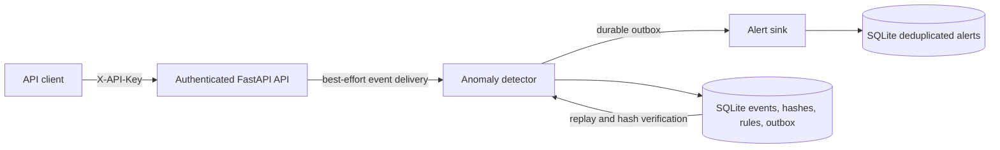

# CogniFlow: Educational MLOps Platform for a Synthetic Cognitive-Load Classifier

[](https://github.com/nhatminh06/personal-cognitive-load-monitor/actions/workflows/ci-cd.yaml)
[](LICENSE)

CogniFlow is an educational Python and MLOps project built around a synthetic classification problem. It demonstrates authenticated APIs, reproducible model development, event processing, persistent anomaly state, deployment configuration, and security-focused CI.

The LOW, MEDIUM, and HIGH labels are synthetic proxies generated from a deterministic rule. They are not clinical, psychological, neurological, or real-world measurements of cognitive load. Do not use this project for diagnosis, employee monitoring, academic decisions, or any decision that affects a person.

## Supported local flow



The API publisher is best effort. The detector persists canonical event content and SHA-256 identities in the same SQLite transaction as its state, rejects conflicting or unverifiable replays with HTTP 409, and delivers alerts through a durable outbox. The alert sink deduplicates persisted alerts. This is not an exactly-once transport claim.

## Implemented components

- Authenticated FastAPI prediction and model-information endpoints.
- Synthetic rule and explicitly selected local-model or KServe inference modes.
- Anomaly processing, deterministic rules, alert generation, and bounded retries.
- SQLite event, hash, rule, outbox, and alert persistence.
- Replay identity and stored-content integrity validation.
- DVC and MLflow-oriented training code using synthetic fixtures.
- Docker, Compose, Helm, Kubernetes, and Terraform configuration for offline review.
- Least-privilege CI with tests, coverage, static checks, and tree plus commit-range secret scanning.

Kubernetes manifests have static and offline validation history. This publication candidate does not claim a current Kubernetes runtime, GKE deployment, cloud registry release, or approved production model. Cloud and image publication workflows are intentionally absent pending separate qualification and authorization.

## Run locally

Requires Python 3.11+ and [uv](https://docs.astral.sh/uv/).

```bash
uv sync --frozen --all-extras
export COGNIFLOW_API_KEY=local-demo-key
export INFERENCE_MODE=demo_rule
uv run uvicorn --app-dir src preprocessing_api.main:app --host 127.0.0.1 --port 8000
```

In another terminal:

```bash
curl --fail --silent --show-error \
  -H 'Content-Type: application/json' \
  -H "X-API-Key: ${COGNIFLOW_API_KEY}" \
  -d '{"focus_minutes":180,"distraction_minutes":60,"tasks_due":3,"hours_to_deadline":24}' \
  http://127.0.0.1:8000/predict
```

The demo uses local synthetic inputs and does not require cloud services.

## Validation scope

| Check | Candidate evidence |
|---|---|
| Python tests and coverage | Re-run locally on the exact candidate; see [publication status](docs/publication-status.md) |
| Ruff and workflow lint | Re-run locally on the exact candidate |
| Secret scanning | Candidate tree and new commit range scanned with the checked-in narrow policy |
| Helm and Kubernetes | Offline lint/render and applicable static checks only |
| Terraform | Offline formatting and provider-backed validation where cached providers are available |
| Hosted GitHub Actions | PASS — [run 44026292995](https://github.com/nhatminh06/personal-cognitive-load-monitor/actions/runs/44026292995) for `f05511cc96cc9644b2d4bcd4d46d98dab7e44d1c` |
| Kubernetes or GKE runtime | NOT RUN for this candidate |
| Container/image scan | NOT RUN for this candidate; no clean-image claim |

Historical reports elsewhere in the repository describe their own dated revisions and environments. They are not results for this candidate. The final measured candidate results and limitations are recorded in [docs/publication-status.md](docs/publication-status.md).

## Reproducibility and generated outputs

`uv.lock`, service requirement locks, `dvc.lock`, and Terraform provider locks record dependency resolution; they do not vendor dependency source code. DVC stages can regenerate synthetic training data, model metrics, and drift reports. Generated notebooks, raw reports, Track B operational evidence, copied upstream manifests, and unverified third-party artifacts are excluded from this candidate.

```bash
uv lock --check --offline
uv run pytest src/tests
uv run ruff check src scripts
helm lint helm/cognitive-load-monitor
helm template cognitive-load-monitor helm/cognitive-load-monitor --namespace cognitive-load
```

## Repository guide

- `src/`: API, eventing, anomaly detection, contracts, focus sessions, and data code.
- `scripts/`: deterministic training, packaging, validation, and local utilities.
- `src/tests/`: application and security regression tests.
- `helm/`, `kserve/`, `deploy/`: offline deployment configuration.
- `infra/`: local and cloud infrastructure definitions; cloud runtime remains unverified.
- `docs/data-card.md`, `docs/model-card.md`, `docs/responsible-use.md`: data, model, and use limitations.
- `docs/publication-status.md`: exact candidate qualification and publication gate.

## Release boundary

Ordinary CI cannot publish images, authenticate to cloud providers, or deploy infrastructure. Manual release and cloud deployment workflows were removed from this candidate because complete post-publication containment and cleanup semantics are not yet qualified. Publication remains blocked until the owner explicitly approves the exact candidate revision and destination.

## License

Original CogniFlow code is provided under the [MIT License](LICENSE). Dependency lockfiles and references do not relicense third-party projects; installed dependencies remain subject to their own licenses.
