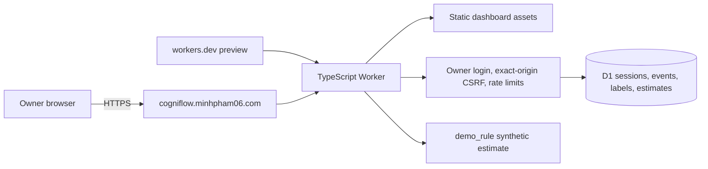
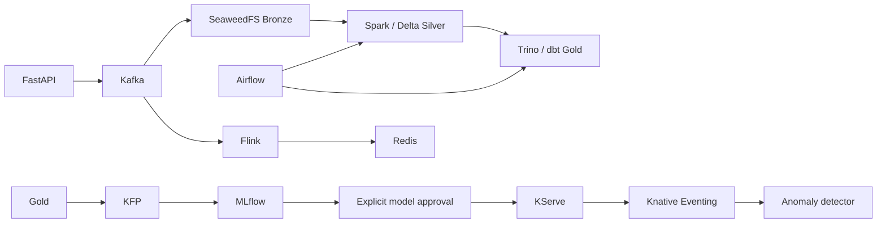

# Architecture

CogniFlow is an educational data-engineering and MLOps platform for a synthetic
cognitive-load classifier. The labels are deterministic proxies, not medical or
workplace measurements.

## Public V0.1 — deployed

Both HTTPS hosts serve the same Worker and D1 database. Cookies are host-only,
Secure, HttpOnly and SameSite=Strict. The Worker provides session lifecycle,
five-minute windows, effort ratings and timeline; `demo_rule` is a synthetic
estimate, not an approved model. Persistent invocation/application logs and
traces are disabled. Production is
[cogniflow.minhpham06.com](https://cogniflow.minhpham06.com); the retained preview
is [workers.dev](https://cogniflow-v01.mphamnhat2006.workers.dev). See the
[live deployment report](readiness/cogniflow-v01-cloudflare-free-deployment.md).

## Future and frozen platform research

The application layer contains authenticated prediction, session, event and
feature APIs. Durable SQLite state supports replay verification, anomaly windows,
transactional alert outboxes and deduplication. Module II supplies offline and
online features. Module III trains and registers candidates, but production
packaging and serving remain approval-gated.

The Linux FastAPI MVP uses Compose and is separate from the public Worker. Helm,
Kubernetes and GCP Terraform remain frozen research; local runtime evidence does
not imply GKE or GCS success. See [Module II](module2.md),
[Module III](module3.md), [deployment](deployment.md), [security](security.md) and
[evidence](evidence.md).
