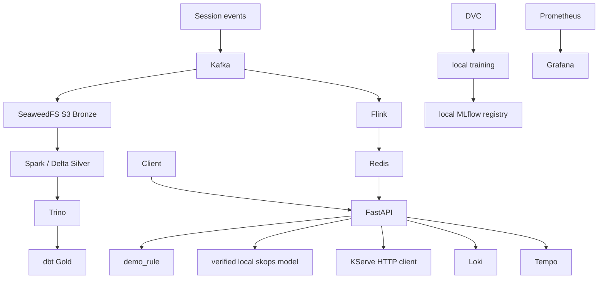

# Implemented architecture

**Current implementation snapshot: 2026-10-26.** This page describes what exists now. The unimplemented grading target is explicitly separated in [`module3/final-rubric-architecture.md`](module3/final-rubric-architecture.md).

## Runtime-verified locally

- FastAPI request validation, authentication, explicit `demo_rule`, `local_model` and `kserve` modes, readiness and no silent fallback.
- Deterministic/DVC training, candidate-only MLflow registration, explicit approval command and exact artifact-tree SHA-256 checks.
- Kafka ingestion, Bronze object persistence, Spark/Delta Silver, Trino/dbt Gold, Airflow fixed-command orchestration, Flink event-time aggregation and Redis freshness protection.
- Prometheus/Grafana metrics, Loki structured logs and Tempo traces in dated Module I/II verification runs.
- Terraform-managed local kind cluster and Helm demo-rule release on loopback port `18000`.

## Implemented but not runtime-verified

- Approval-bound Phase 3 model packaging and isolated local-model Helm release. The current MLflow version 2 remains a candidate, so no image or deployment exists.
- KServe client behavior and `InferenceService` manifests. They have been unit-tested/rendered, not run with KServe.
- GKE Terraform, Workload Identity definitions, GCS bucket and cloud deployment workflow. They are statically validated only.

## Not implemented

- Kubeflow Pipelines training orchestration.
- A custom KServe runtime that loads the verified `.skops` package.
- Knative Eventing logging Broker/Trigger/consumer.
- Knative-based real-time anomaly detector.
- Authorized GKE/GCS runtime and full demonstration video.

## Stable serving contract

`INFERENCE_MODE` accepts only `demo_rule`, `local_model` or `kserve`. Explicit modes use only the selected backend; absence, timeout, invalid output or provenance failure returns a visible failure and keeps readiness closed. The six ordered feature names and `PredictionResponse` remain stable. `/model-info` reports verified manifest-backed provenance in local-model mode.

The stock KServe sklearn server does not document `.skops` support, so the final target uses a digest-pinned custom KServe Python runtime that reuses the existing manifest/trusted-type checks. See the [final architecture](module3/final-rubric-architecture.md).

## Deployment ownership and restrictions

- Terraform owns the existing local demo release; experimental Helm releases use separate namespaces and names.
- PersonalOS remains on host port `8000`; CogniFlow demo access is `18000`; experimental serving reserves `18001`.
- Cloud deployment must pin OCI repository digests and enforce image signatures/attestations.
- SEC-022 Spark is accepted only for isolated local development with trusted synthetic data and is prohibited in Kubernetes/GKE.
- No current evidence claims KServe scale-to-zero, cloud HPA behavior, production ingress, GCS-backed artifacts or cloud security controls.
