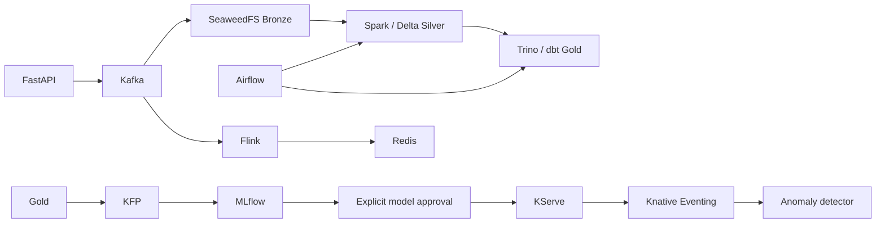

# Architecture

CogniFlow is an educational data-engineering and MLOps platform for a synthetic
cognitive-load classifier. The labels are deterministic proxies, not medical or
workplace measurements.

The application layer contains authenticated prediction, session, event and
feature APIs. Durable SQLite state supports replay verification, anomaly windows,
transactional alert outboxes and deduplication. Module II supplies offline and
online features. Module III trains and registers candidates, but production
packaging and serving remain approval-gated.

Deployment configuration includes Compose, Helm, Kubernetes and Terraform. Local
runtime evidence does not imply GKE or GCS success. See [Module II](module2.md),
[Module III](module3.md), [deployment](deployment.md), [security](security.md) and
[evidence](evidence.md).
