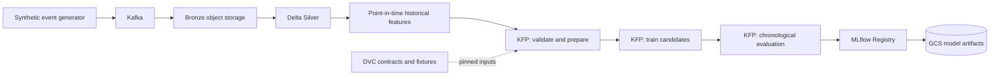
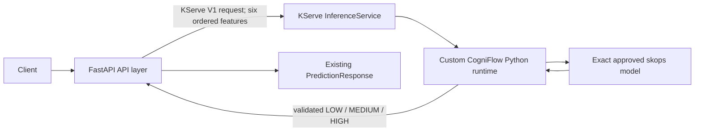
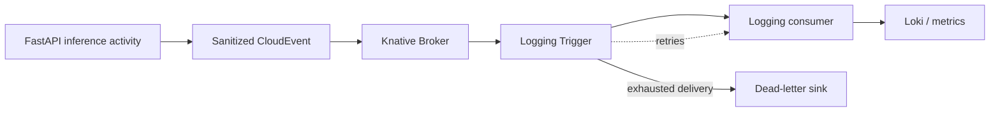
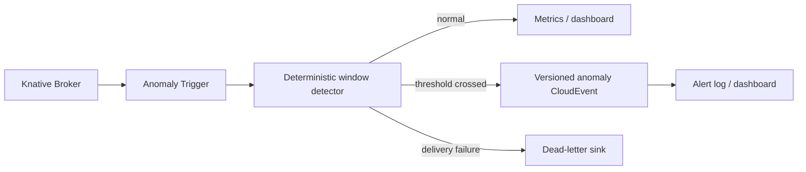
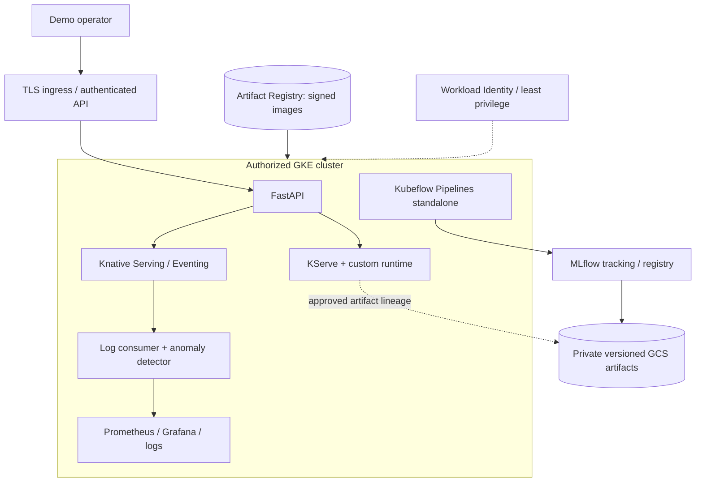

# Final rubric architecture

**Design target, not a runtime-completion claim. Last reviewed: 2026-10-26.** Solid arrows below describe the intended final flow. Current verification levels are recorded in [`../course-rubric-2026.md`](../course-rubric-2026.md).

## Offline training

Kubeflow Pipelines v2 standalone is the primary orchestrator. Components reuse the existing bounded preparation and Phase 2 training code rather than reimplementing feature logic. Each run pins the Delta version or immutable fixture digest, training manifest digest, code revision, component image digest and feature schema. Selection uses validation data; only the selected candidate sees the held-out test partition. Registration remains `candidate` and does not imply approval.

Airflow remains the verified local Bronze-to-Gold batch orchestrator. It is not described as a Kubeflow training pipeline. KFP artifacts use a configured pipeline root; in the cloud that root and MLflow model artifacts use private GCS paths with separate least-privilege identities.

## Online inference

The stock KServe sklearn runtime documents `.joblib`, `.pkl` and `.pickle` model files, whereas the Phase 2 candidate is serialized as `.skops`. Therefore CogniFlow must use a small custom KServe Python model server, not claim that the default sklearn server can load it. The custom runtime will reuse the existing pre-deserialization SHA-256, manifest, trusted-type and provenance checks. It will implement KServe's V1 prediction protocol and expose readiness only after the exact approved artifact is verified and loaded.

The FastAPI boundary remains stable:

- request fields and `PredictionResponse` do not change;
- the canonical `1.0` feature contract has six ordered values from `preprocessing_api.features.FEATURE_NAMES`;
- `inference_source` and exact model version remain explicit;
- unknown labels, invalid payloads, unavailable serving and provenance mismatches fail closed;
- no `demo_rule` or local-model fallback is permitted in explicit KServe mode.

The runtime image must be pinned by OCI repository digest, signed and attested before cloud use. It runs non-root with a read-only root filesystem, dropped capabilities, bounded resources and no broad bucket credentials. Packaging an approved artifact into the image is the smallest initial architecture; it avoids runtime deserialization of mutable remote content. GCS remains the registry artifact authority and is independently verified before the image is built. A storage initializer can be considered later only with equivalent generation/digest enforcement.

## Knative event processing

Stable event contract `io.cogniflow.inference.activity.v1`:

| Field | Rule |
|---|---|
| CloudEvent `id` | UUID generated once per inference result; deduplication key |
| `source` | Fixed service URI, not a user-controlled URL |
| `type` / `specversion` | Exact versioned values; CloudEvents 1.0 |
| `time` | UTC inference completion timestamp |
| `subject` | Pseudonymous request/session reference only when required |
| `correlationid` extension | Validated opaque correlation ID propagated through services |
| Data | outcome class, inference source, model version, latency bucket, HTTP status family, feature-age bucket and schema version |

Raw feature values, request bodies, API keys, credentials, IP addresses and user-controlled headers are excluded. The producer applies a bounded timeout and reports publish failure without changing prediction semantics. The Trigger configures a finite retry count, exponential backoff and a dead-letter sink. Consumers store event IDs for a bounded retention window and acknowledge duplicates without repeating side effects. Broker, Trigger, consumer and dead-letter metrics make failure visible.

Kafka, Flink and Loki remain useful supporting services; none substitutes for the required real Knative Broker/Trigger path.

## Real-time anomaly detection

The first implementation uses deterministic, configuration-versioned thresholds over event-time tumbling windows; EWMA is added only if deterministic fixtures show a useful advantage. Initial objective signals are inference error ratio, p95 latency, request rate and stale-feature ratio. Each rule defines minimum sample count, threshold, window, cooldown and recovery condition. The alert key is `rule_version + rule_id + window_start`; this makes redelivery idempotent and suppresses repeated alerts during cooldown.

Acceptance fixtures include quiet traffic, a boundary case and one injected anomaly per rule. Measured detection latency runs from the anomalous event time to accepted alert time. These are service-health anomalies, not medical cognitive-load anomalies.

## Authorized cloud deployment

Required controls before runtime acceptance:

- dedicated Kubernetes namespaces, ResourceQuotas, LimitRanges, default-deny NetworkPolicies, Pod Security admission and narrowly scoped RBAC;
- Workload Identity service accounts separated for KFP, MLflow, serving and CI; no static service-account keys;
- TLS, authenticated ingress and bounded outbound HTTP; private or authorized control-plane access;
- admission-time verification of signed image digests and attestations, plus exact model/artifact digests;
- GCS uniform bucket-level access, public-access prevention, versioning, retention appropriate to the demo and audit logs;
- monitored budgets, alerts, short deployment window and explicit teardown ownership.

The SEC-022 Spark image is prohibited in production, staging, Kubernetes and GKE. Cloud training consumes already materialized trusted features or uses a separately remediated runtime; the accepted local-development exception never crosses this boundary.

## Source references

- [KServe custom model server](https://kserve.github.io/website/docs/model-serving/predictive-inference/frameworks/custom-predictor)
- [KServe sklearn file formats](https://kserve.github.io/website/docs/model-serving/predictive-inference/frameworks/sklearn)
- [Kubeflow Pipelines concepts](https://www.kubeflow.org/docs/components/pipelines/concepts/pipeline/)
- [Kubeflow pipeline roots](https://www.kubeflow.org/docs/components/pipelines/concepts/pipeline-root/)
- [Knative delivery, retries and dead-letter sinks](https://knative.dev/docs/eventing/configuration/broker-configuration/)
