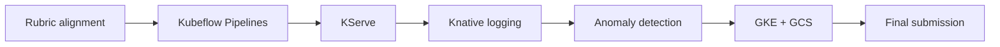

# Module III implementation roadmap

This is an executable dependency plan, not proof that future components exist. PR numbers are labels only; if a number is unavailable, use the next available PR and preserve the dependency order.

## PR #12 — rubric alignment

- **Prerequisites:** PR #11 merged; clean `main`; no cloud or model approval required.
- **Deliver:** authoritative weighted rubric, final architecture, evidence contract, roadmap, resource/cost plan and refreshed submission documentation.
- **Pass:** weights total 60% technical + 40% practical; every requirement has status, acceptance test and evidence; links and Mermaid parse; lint/security/CI pass.
- **Fail:** any planned service is called verified, GCE and GKE scores are added, or historical evidence is presented as current cloud evidence.
- **Checks:** Markdown link/path validator, Mermaid CLI when available, `git diff --check`, Ruff, MyPy, Pytest coverage gate and Gitleaks.
- **Rollback:** revert documentation commit only; no runtime state changes.
- **Downstream:** establishes contracts and acceptance evidence for all later PRs.

## PR #13 — Kubeflow Pipelines

- **Prerequisites:** PR #12; pinned KFP/API versions; sufficient isolated cluster resources; immutable Delta version or fixture manifest.
- **Deliver:** KFP v2 components for validate/prepare, train, evaluate and MLflow candidate registration; compiled pipeline; pinned component image digests; bounded parameters.
- **Pass:** an actual run completes all components; manifest lineage, chronological splits, six-feature schema, run/component image digests and candidate registry version match. Failed validation prevents training/registration.
- **Fail:** local sequential scripts are called a KFP run, mutable `latest` images are used, test data influences selection, or a run auto-approves a model.
- **Checks:** compile pipeline; run deterministic 180-row fixture; query KFP run state/logs; verify MLflow tags and artifact-tree digest; run negative manifest/schema/split tests.
- **Evidence:** compiled YAML, pipeline/run IDs, component logs, UI captures, dataset manifest, MLflow run/version and digest transcript.
- **Rollback:** delete only the test run and PR-owned namespace/resources; retain referenced immutable artifacts according to evidence policy.
- **Downstream:** produces a candidate eligible for separate owner review; PR #14 requires an explicitly approved exact version.

## PR #14 — KServe

- **Prerequisites:** PR #13; owner approval of an exact synthetic-demo model version and artifact digest; KServe compatibility matrix and resource budget.
- **Deliver:** custom KServe Python runtime for verified `.skops`, immutable image, `InferenceService`, FastAPI integration and operational rollback.
- **Pass:** `InferenceService` Ready; FastAPI `/predict` contract parity for LOW/MEDIUM/HIGH; `/model-info` matches approved lineage; corrupt/missing/wrong-digest/unknown-class/backend-unavailable cases fail closed; restart recovery succeeds.
- **Fail:** default sklearn server is assumed to load `.skops`, a candidate is deployed, an image tag substitutes for a digest, or FastAPI silently falls back.
- **Checks:** local disposable runtime smoke; Helm/KServe validation; live readiness and request tests; provenance checks; rollout and rollback. If scale-to-zero is pursued, observe zero replicas, cold activation and a valid response separately.
- **Evidence:** image digest/signature/attestation, model manifest, `InferenceService` conditions/events, endpoint transcripts and recovery timing.
- **Rollback:** restore the previous verified image/revision; remove only the isolated serving resources.
- **Downstream:** PR #15 records activity from the verified inference path.

## PR #15 — Knative log eventing

- **Prerequisites:** PR #14; Knative Eventing installed with pinned manifests; privacy review of event v1.
- **Deliver:** sanitized CloudEvent producer, Broker, logging Trigger/consumer, bounded retries, deduplication and dead-letter sink.
- **Pass:** one prediction yields one correlated sanitized event at the consumer; redelivery does not duplicate side effects; forced consumer failure retries then reaches the dead-letter sink; no prohibited field appears.
- **Fail:** direct logs bypass the Broker, payloads contain raw inputs/credentials, delivery retries forever, or failures are invisible.
- **Checks:** schema/unit tests; live Broker/Trigger Ready checks; successful delivery, duplicate, timeout, retry and DLQ integration tests.
- **Evidence:** redacted event, correlation/event IDs, resource conditions, consumer/DLQ logs and delivery metrics.
- **Rollback:** disable producer and delete only versioned PR-owned Trigger/consumer resources; preserve API serving.
- **Downstream:** PR #16 subscribes to the same stable event contract.

## PR #16 — real-time anomaly detection

- **Prerequisites:** PR #15; versioned deterministic fixtures and agreed thresholds/SLO.
- **Deliver:** Knative subscriber with bounded window state, objective API anomaly rules, alert CloudEvent, dedupe/cooldown and dashboard metrics.
- **Pass:** normal and boundary fixtures produce no inappropriate alerts; each injected error/latency/rate/staleness anomaly produces exactly one alert inside the stated latency SLO; replay is idempotent.
- **Fail:** detector claims medical inference, alerts have no reproducible cause, or replay produces alert storms.
- **Checks:** unit property/boundary tests; live normal/anomaly traffic; replay/restart; measure detection latency and false positives on the fixture.
- **Evidence:** rule config/version, event/alert pair, metrics, dashboard capture and latency table.
- **Rollback:** remove anomaly Trigger/deployment only; logging event flow remains operational.
- **Downstream:** completes the 60% technical runtime flow for cloud integration.

## PR #17 — GKE and GCS integration

- **Prerequisites:** PRs #13–#16; explicit owner approval for budget, Terraform apply and model deployment; production security review; billing alerts.
- **Deliver:** authorized GKE deployment of grading-relevant components; GCS-backed MLflow artifacts; Workload Identity, TLS, least privilege, signed-image policy, monitoring and teardown automation.
- **Pass:** all workloads Ready; a KFP run registers to MLflow/GCS; independently retrieved bytes match the registry digest; approved model serves through KServe/FastAPI; Knative logging/anomaly flow succeeds; cost and security evidence are captured.
- **Fail:** Spark SEC-022 runtime reaches GKE, public buckets/credentials exist, mutable images deploy, or teardown cannot identify owned resources.
- **Checks:** reviewed Terraform plan then explicitly authorized apply; IAM/policy tests; full demo rehearsal; failure recovery; billing and teardown verification.
- **Evidence:** redacted plan/apply logs, resource inventory, IAM bindings, GCS object generation/digest, workload conditions, full-flow transcript and cost report.
- **Rollback:** Helm/manifest rollback first; destroy only Terraform-owned cloud resources after evidence retention and separate approval. Never touch PersonalOS or unrelated state.
- **Downstream:** provides runtime evidence for final submission.

## PR #18 — final submission

- **Prerequisites:** PR #17 accepted; all rubric evidence indexed; demonstration rehearsal passed.
- **Deliver:** reproducible README, final evidence matrix, release tag and real full-flow demonstration video.
- **Pass:** a fresh operator can follow the documented path; video covers all 15 steps in [`../demo/full-rubric-demo.md`](../demo/full-rubric-demo.md); links/digests/run IDs resolve; all checks pass.
- **Fail:** screenshots/logs are fabricated, planned work is marked complete, secrets appear, or the video omits a weighted component.
- **Checks:** clean-clone documentation test, full regression, link/evidence validation, secret/container/IaC scans, one complete timed demo and safe teardown.
- **Evidence:** submitted repository URL, video URL/checksum, release commit, CI run, evidence index and final cost/teardown report.
- **Rollback:** withdraw the release/documentation reference; do not erase immutable audit evidence. Tear down cloud resources through the approved PR #17 procedure.

## Cross-cutting gates

Every implementation PR preserves the six-feature `1.0` contract, synthetic-proxy disclaimer, exact registry identity, candidate/approved separation, SHA-256 provenance, signed immutable images, non-root/read-only workloads, bounded requests, no silent fallback, no telemetry secrets, read-only Trino access and SEC-022's local-development-only boundary.
