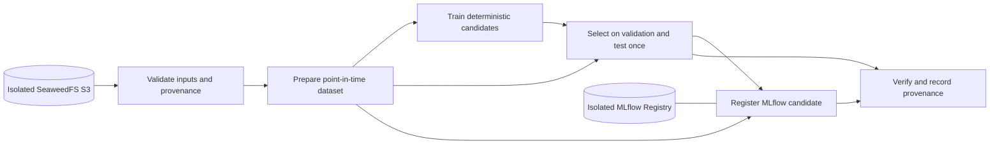

# Kubeflow training integration

This is the Module III milestone after Phase 3 serving. It implements and verifies a real Kubeflow Pipelines (KFP) v2 training graph; it does not approve or deploy a model.

## Verified architecture



KFP schedules the six boxes as separate Kubernetes tasks. Artifacts move through the configured S3-compatible pipeline root; tasks do not share host paths. The implementation reuses the Phase 2 validators, chronological splitter, candidates and metric calculation in `src/cogniflow_data/training.py`.

## Pinned software and image identity

The verified local run used:

- KFP standalone backend `2.17.2` and Python SDKs `kfp==2.17.3`, `kfp-kubernetes==2.17.3`.
- kind `cogniflow-kfp`, isolated from the Terraform-owned `cogniflow-local` cluster.
- Component image `localhost:5001/cogniflow-kfp@sha256:8cd171d9d71610e0a29469d86f94caa638662e201563a038d2db06976c43a614`.
- Embedded source revision `26bbc3fdbbeb40e41167e73e5726dbcefe05b7a0`.
- In-cluster SeaweedFS from the standalone KFP development installation and an isolated MLflow service from `infra/kfp-local/mlflow.yaml`.

The KFP `env/dev` overlay at tag `2.17.2` renders KFP application images and its driver/launcher environment as mutable `master`. Before accepting a run, the local installation was patched to the corresponding `2.17.2` release images, including `V2_DRIVER_IMAGE` and `V2_LAUNCHER_IMAGE`. The unpatched combination failed before task scheduling and is not valid evidence. The component image itself was built, pushed to a loopback registry, resolved by containerd and executed by repository digest; a Docker image ID was never substituted for that digest.

## Build, compile and local installation

These commands intentionally target only the disposable cluster. Check available memory first; the observed control-plane container used about 4.21 GiB during the completed run.

```bash
git rev-parse HEAD
docker run -d --restart=always -p 127.0.0.1:5001:5000 --name cogniflow-kfp-registry registry:2
kind create cluster --config infra/kfp-local/kind-config.yaml --kubeconfig /tmp/cogniflow-kfp-kubeconfig
docker network connect kind cogniflow-kfp-registry

docker build --build-arg COGNIFLOW_CODE_REVISION="$(git rev-parse HEAD)" \
  -f Dockerfile.kfp -t localhost:5001/cogniflow-kfp:"$(git rev-parse --short=12 HEAD)" .
docker push localhost:5001/cogniflow-kfp:"$(git rev-parse --short=12 HEAD)"
# Record the RepoDigest returned by the push, then compile with that exact value.
uv run --extra kubeflow python scripts/compile_kfp_pipeline.py \
  --component-image localhost:5001/cogniflow-kfp@sha256:<repository-digest> \
  --output pipelines/compiled/cogniflow-training.yaml

kubectl --kubeconfig /tmp/cogniflow-kfp-kubeconfig apply -k \
  github.com/kubeflow/pipelines/manifests/kustomize/cluster-scoped-resources?ref=2.17.2
kubectl --kubeconfig /tmp/cogniflow-kfp-kubeconfig wait --for condition=established \
  --timeout=60s crd/applications.app.k8s.io
kubectl --kubeconfig /tmp/cogniflow-kfp-kubeconfig apply -k \
  github.com/kubeflow/pipelines/manifests/kustomize/env/dev?ref=2.17.2
```

For this single-tenant disposable development backend, replace every KFP `:master` deployment image produced by `env/dev` with the same component's `:2.17.2` tag. Also set these API-server values and wait for rollout before submitting a run:

```bash
kubectl --kubeconfig /tmp/cogniflow-kfp-kubeconfig -n kubeflow set env deployment/ml-pipeline \
  V2_DRIVER_IMAGE=ghcr.io/kubeflow/kfp-driver:2.17.2 \
  V2_LAUNCHER_IMAGE=ghcr.io/kubeflow/kfp-launcher:2.17.2
kubectl --kubeconfig /tmp/cogniflow-kfp-kubeconfig apply -f infra/kfp-local/kfp-launcher.yaml
kubectl --kubeconfig /tmp/cogniflow-kfp-kubeconfig apply -f infra/kfp-local/mlflow.yaml
kubectl --kubeconfig /tmp/cogniflow-kfp-kubeconfig -n kubeflow wait \
  --for=condition=Available deployment --all --timeout=420s
```

The upstream development inverse proxy requires `hostNetwork` and does not satisfy a restricted Pod Security profile. It was permitted only in the disposable single-tenant namespace. Do not reuse this development installation as production configuration.

## Inputs, submission and contracts

Generate only the bounded fixture, upload its three files to the isolated KFP object store, and submit the compiled YAML through a loopback-only API port-forward. Runtime parameters must name immutable S3 objects, the full Git SHA, the cutoff and the in-cluster MLflow service. Caching is disabled.

The positive run enforced:

- feature schema `1.0` and exact ordered features `focus_minutes`, `distraction_minutes`, `tasks_due`, `hours_to_deadline`, `focus_ratio`, `distraction_ratio`;
- feature input SHA-256 `55be9fae099b47c1cb22a09a93adfa7a565088ff3a463ef4db3ebf90b25eb3c7`;
- label input SHA-256 `42e061d307ae44a9c0a0c8c94b8edbadb9b09312ba258e4118f4c6d4c0422d5f`;
- dataset SHA-256 `6679e9edb87451ee968e21c0aef5280226b2cf609554e048ec365378c3aca80f`;
- chronological train/validation/test splits `108/36/36`;
- `synthetic_proxy` label provenance and no invented Delta version (`source_delta_versions` is empty).

Tasks run as UID/GID `10001`, request `250m` CPU and `512Mi` memory, are limited to one CPU and 2 GiB, and have a 600-second deadline. The image contains locked dependencies and tasks perform no dynamic package installation.

## Runtime evidence — 2026-10-26

Positive KFP run `cee7540f-9c9e-4078-a9d7-c61c4c4bd9fc` finished `Succeeded`. Kubernetes workflow `cogniflow-kubeflow-training-tr66g` showed successful validate, prepare, train, evaluate/select, register and provenance tasks. The object store retained explicit validation, dataset, manifest, candidates, validation metrics, selected model, evaluation, registration and provenance artifacts.

The selected `random_forest` achieved validation macro-F1 `1.0` and held-out test macro-F1 `1.0` on the deterministic synthetic proxy fixture. These figures demonstrate pipeline correctness only; they are not evidence of real-world cognitive-load accuracy.

MLflow run `d2664d034b5f490e8de7ba59bba29aab` registered `cognitive-load-classifier-kfp` version `1` with `approval_status=candidate`. The independently retrieved registered artifact tree had SHA-256 `80fdf4f2cc52e9407ce85f29d9804a69634568196c8ab4b09bb0ac8ee6659988`. Tags matched the KFP run, exact component image, dataset digest, source revision, schema and synthetic provenance. No approval or deployment occurred.

Negative KFP run `5143c5ae-9c98-4c4d-9f21-f5647ec63cf9` finished `Failed` with `ValueError: feature manifest checksum mismatch`. Only three importer tasks and the validation task were scheduled; no prepare, train, evaluate or registration task existed. This is the required fail-closed propagation proof.

Initial disposable attempts exposed three installation/runtime issues before the accepted run: the development overlay's `master` driver mismatch, missing S3 provider region, and an under-sized 1 GiB MLflow service. The final configuration pins driver/launcher `2.17.2`, uses the official provider schema in `infra/kfp-local/kfp-launcher.yaml`, explicitly allowlists MLflow service hosts, and bounds MLflow at 2 GiB with one worker.

Release verification passed with 161 Pytest tests and 89.60% combined coverage against the 81% gate, Ruff, MyPy, Helm lint/render, and DVC reproduction. DVC regenerated the same 180-row dataset digest while refreshing dependency hashes for the shared refactor. Gitleaks found no secret in the intended diff. Trivy `0.67.2` found zero fixable High/Critical OS or Python findings in the exact component image archive. Graphify's post-change code graph contains 949 nodes and 1,989 edges; it traces KFP task code to the existing `training.py`, `historical.py`, and shared `preprocessing_api/features.py` contracts rather than a duplicate feature implementation. Graphify documentation semantics were not refreshed because no supported LLM backend was configured; the deterministic code graph was refreshed locally.

## Inspection, retention and cleanup

Use loopback-only forwarding for the development UI/API:

```bash
kubectl --kubeconfig /tmp/cogniflow-kfp-kubeconfig -n kubeflow port-forward svc/ml-pipeline-ui 18080:80
kubectl --kubeconfig /tmp/cogniflow-kfp-kubeconfig -n kubeflow get workflows,pods
kubectl --kubeconfig /tmp/cogniflow-kfp-kubeconfig -n kubeflow logs <task-pod> -c main
```

Artifacts live only in the disposable cluster's KFP SeaweedFS store and are deleted with that explicitly owned cluster. Export evidence before cleanup. The existing Module II SeaweedFS volumes, Terraform state, `cogniflow-local` cluster, PersonalOS and ports 8000/18000 are not touched.

```bash
kind delete cluster --name cogniflow-kfp
docker stop cogniflow-kfp-registry
docker rm cogniflow-kfp-registry
```

Rollback removes only the disposable cluster and loopback registry. It must never delete named Docker volumes or the `cogniflow-local` cluster.

## Remaining boundaries

This verifies the local 15% training-pipeline runtime criterion. It does not verify a production KFP installation, GKE/GCS, multi-user isolation, signed images, an approved model, KServe, Knative or cloud MLflow. The standalone development manifest's security profile is unsuitable for untrusted users or data.
