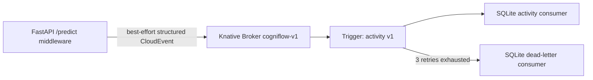

# Phase 6: Knative Eventing inference activity capture

**Verification date:** 2026-10-26. **Scope:** isolated local development with synthetic `demo_rule` requests. This does not prove KServe, cloud, or production operation.

## Architecture and guarantees



The API middleware emits at most one activity event after each `/predict` result. Publication is synchronous, bounded to five seconds or less, and best-effort: a telemetry failure is counted and logged but cannot alter the prediction response or select another inference backend. It is disabled by default. Once the consumer returns `204`, the sanitized event has committed to SQLite with `synchronous=FULL`; `(source, id)` is the durable uniqueness key. This is not end-to-end exactly-once delivery.

The local MTChannelBasedBroker uses InMemoryChannel. Consumer records survive consumer Pod restarts through a 256 MiB PVC, but events waiting inside the in-memory channel can be lost with the dispatcher/node. Production needs a persistent supported channel.

## Event contract

Type `org.cogniflow.inference.activity.v1`, data schema `1.0`, CloudEvents `1.0`:

| Field | Validation |
|---|---|
| `id`, `data.correlation_id` | UUIDs generated by CogniFlow |
| `source` | exact `urn:cogniflow:preprocessing-api` |
| `time` | timezone-aware UTC timestamp |
| `outcome` / `http_status` | consistent success/failure and HTTP 100–599 |
| `inference_backend` | `demo_rule`, `local_model`, or `kserve` |
| `latency_ms` | finite 0–3,600,000 ms |
| `failure_category` | bounded classification; `none` only for success |
| model identity/version | optional restricted identifier strings |

The serialized event is limited to 4096 bytes. Request bodies, raw features, headers, API keys, IP addresses, private identifiers, stack traces, and medical conclusions are never copied. Invalid payloads receive a generic response and are not logged.

## Pinned local installation

- Kubernetes `v1.34.0` in kind cluster `cogniflow-eventing`.
- Knative Eventing `v1.23.0` (supported with minimum Kubernetes 1.34 on the verification date).
- `eventing-crds.yaml`, `eventing-core.yaml`, `in-memory-channel.yaml`, and `mt-channel-broker.yaml` checksums are pinned in `deploy/knative/KNATIVE_EVENTING_V1.23.0_SHA256SUMS`.
- Knative Serving, KServe, KFP, GCP, and Argo CD are not installed.

Download release files to a disposable directory, run `sha256sum --check` against the repository manifest, then:

```bash
kind create cluster --config infra/knative-eventing/kind-config.yaml \
  --kubeconfig /tmp/cogniflow-eventing-kubeconfig --wait 120s
kubectl --kubeconfig /tmp/cogniflow-eventing-kubeconfig apply -f eventing-crds.yaml
kubectl --kubeconfig /tmp/cogniflow-eventing-kubeconfig apply -f eventing-core.yaml
kubectl --kubeconfig /tmp/cogniflow-eventing-kubeconfig apply -f in-memory-channel.yaml
kubectl --kubeconfig /tmp/cogniflow-eventing-kubeconfig apply -f mt-channel-broker.yaml
docker build -f Dockerfile.event-consumer -t cogniflow-event-consumer:dev .
docker build -f Dockerfile -t cogniflow-api-eventing:dev .
kind load docker-image cogniflow-event-consumer:dev cogniflow-api-eventing:dev \
  --name cogniflow-eventing
kubectl --kubeconfig /tmp/cogniflow-eventing-kubeconfig apply \
  -f deploy/knative/namespace.yaml -f deploy/knative/consumer.yaml \
  -f deploy/knative/dead-letter.yaml -f deploy/knative/api-demo.yaml \
  -f deploy/knative/broker.yaml -f deploy/knative/trigger.yaml
```

All application Services are `ClusterIP`. Temporary access uses an unused loopback-only port:

```bash
kubectl --kubeconfig /tmp/cogniflow-eventing-kubeconfig \
  -n cogniflow-eventing port-forward service/cognitive-load-api 18015:80 \
  --address 127.0.0.1
```

## Actual runtime evidence

| Check | Result |
|---|---|
| Knative controllers | all Eventing, IMC, and MT Broker deployments Available |
| Broker / Trigger | `cogniflow-v1 Ready=True`; `inference-activity-v1 Ready=True` |
| Real prediction | HTTP 200, `MEDIUM`, `demo_rule`, no fallback |
| Correlation | response/event `1435493e-b432-4fe6-b352-6c745a680f3b` matched |
| Durable event | event `33fb0ed9-4b13-41f3-9da5-cdc30b444a31` committed to SQLite |
| Delivery latency | 41.699 ms from CloudEvent time to SQLite `received_at` |
| Replay | same event replayed; row count remained 1; duplicate metric became 1 |
| Restart | consumer Pod replaced; PVC-backed row count remained 1 |
| Temporary failure | consumer removed then restored during finite retry; primary rows increased 1→2 |
| Exhausted retries | event `1aa853e4-7158-499f-9c41-760f7c010325` reached the DLQ after 3 retries |
| Resources | kind node measured 1.231 GiB memory and 7.06% CPU after tests |

The Trigger reports exponential backoff from 1 second and three retries (four total attempts). The InMemoryChannel runtime status independently showed the same subscriber delivery configuration and resolved dead-letter URI. Runtime IDs are evidence from this disposable run, not stable configuration.

The first consumer-image scan found 39 fixable Debian and six Python High/Critical occurrences in the original dependency snapshot. The Dockerfile was hardened with current OS packages, current compatible FastAPI/Starlette dependencies, and removal of build tooling. A socket-free Trivy 0.67.2 rescan of the exported hardened image reported **0 fixable High/Critical Debian findings and 0 Python findings**. The rebuilt consumer was loaded, both consumer Pods restarted, the existing two primary rows survived, and another real prediction increased the primary store to three rows.

## Security boundary

Consumers run as UID/GID 10001 with read-only roots, dropped Linux capabilities, no service-account token, bounded resources, bounded request/event sizes, and internal-only Services. They strictly validate CloudEvents but do not authenticate senders cryptographically; local isolation and the ClusterIP boundary are compensating controls. Do not describe this development topology as authenticated or production-ready.

## Tests, inspection, and rollback

```bash
uv run pytest --cov --cov-fail-under=81
uv run ruff check .
uv run mypy --explicit-package-bases --ignore-missing-imports \
  src/preprocessing_api src/cogniflow_data src/cogniflow_eventing
kubectl --kubeconfig /tmp/cogniflow-eventing-kubeconfig \
  -n cogniflow-eventing get broker,trigger,pods,pvc
kubectl --kubeconfig /tmp/cogniflow-eventing-kubeconfig \
  -n knative-eventing logs deployment/imc-dispatcher
```

Disable only new publication with `INFERENCE_ACTIVITY_ENABLED=false`. To remove the isolated proof after retaining evidence:

```bash
kind delete cluster --name cogniflow-eventing
```

This does not touch `cogniflow-local`, PersonalOS, Terraform state, model artifacts, or named Docker volumes.

The verified disposable cluster was deleted after evidence capture. `kind get clusters` then listed only `cogniflow-local`; its control-plane remained running.
