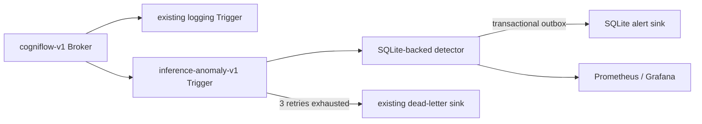

# Phase 7: Knative real-time inference-health anomaly detection

**Verification date:** 2026-10-26 (America/Chicago) / 2026-10-27 UTC. **Scope:** deterministic service-health anomalies over the existing sanitized activity CloudEvent. This detector does not identify medical, psychological, or cognitive anomalies. All demonstration provenance is `synthetic_demo`.

## Architecture



The second Trigger filters the stable `org.cogniflow.inference.activity.v1` type and does not alter the original logging Trigger. The detector reuses the same strict parser. A single SQLite transaction deduplicates `(source,id)`, retains bounded event state, evaluates rules, persists alert decisions and appends the outbox. The sink is internal-only and deduplicates `(source,id)` again.

## Demonstration rule contract

These deliberately small thresholds are for deterministic local evidence, not production alert policy.

| Rule ID / version | Sliding window | Minimum | Trigger | Cooldown | Normal / boundary / anomaly |
|---|---:|---:|---|---:|---|
| `inference_error_ratio` / `1.0` | 60 s | 4 | error ratio `>= 0.5` | 60 s | below 0.5 / exactly 0.5 alerts / above alerts |
| `inference_mean_latency_ms` / `1.0` | 60 s | 3 | mean latency `>= 500 ms` | 60 s | below 500 / exactly 500 alerts / above alerts |
| `inference_request_count` / `1.0` | 60 s | 6 | request count `> 5` | 60 s | five or fewer / five does not alert / six alerts |

Windows use event time and are evaluated at each accepted event. Events up to 10 seconds behind the greatest observed event time are accepted; older events are acknowledged as late and excluded. Window state is retained for one hour and capped at 10,000 records. Delivery identities are retained independently for seven days, covering the supported Knative retry horizon, and capped at 100,000 records; the oldest identities are removed first. Duplicate delivery after window eviction therefore remains idempotent during that horizon. A rule/backend alert inside its cooldown is counted as suppressed.

Feature staleness is intentionally absent: activity schema `1.0` contains no validated feature timestamp. Inferring it from request time, model identity, latency or raw features would be misleading and would weaken the privacy contract.

## Alert contract

Type `org.cogniflow.inference.anomaly.v1`, schema `1.0`, source `urn:cogniflow:anomaly-detector`. The deterministic anomaly ID is SHA-256 of rule ID/version, backend and triggering event ID. Payload fields are limited to anomaly/rule identity, UTC detection and window timestamps, backend category, observed metric, threshold/operator, sample count, severity, triggering event ID and `synthetic_demo` provenance. Credentials, correlation IDs, request inputs, IP addresses, private identifiers and medical conclusions are excluded.

## Failure and recovery

Alert publication occurs only after the state transaction commits. The HTTP subscriber acknowledges a successfully persisted activity event with `204`; an alert waiting in the independent outbox does not turn that success into `503`. A lifespan worker drains four rows per batch on startup and after each accepted event, retries without requiring new traffic, and uses capped exponential backoff from 250 ms to 30 seconds. Shutdown wakes and joins the worker safely. Failed publication increments the attempt count and leaves `published_at` empty; a sink acknowledgement marks it published. Therefore a crash between state commit and publication cannot silently discard the alert. Delivery is at-least-once and both endpoints are idempotent.

SQLite calls and synchronous HTTP publication run in worker threads, not on FastAPI's event loop. Each service admits at most eight concurrent request jobs, detector and sink writes are serialized, and every connection closes after commit or rollback while retaining WAL and `synchronous=FULL`. The detector rejects a new, not-yet-persisted event with `503 durable alert backlog full` only when 10,000 unpublished durable outbox rows already exist. Existing rows remain recoverable; no accepted event is reported as failed solely because its alert is pending.

The development Broker still uses `InMemoryChannel`; queued activity events may be lost with its dispatcher or node. Production requires a persistent supported channel, authenticated workload-to-workload transport, production thresholds, retention review and an externally durable database.

The production activity destination is exactly `http://broker-ingress.knative-eventing.svc.cluster.local/cogniflow-eventing/cogniflow-v1`, matching the checked-in versioned Broker and both Triggers. Helm rejects any different namespace/name or placeholder destination in production; `test_production_broker_destination_matches_versioned_manifests` guards the cross-component contract.

## Local deployment and verification

Use only a separately owned disposable `cogniflow-eventing` kind cluster. Do not target `cogniflow-local`.

```bash
docker build -f Dockerfile.anomaly-detector -t cogniflow-anomaly-detector:dev .
kind load docker-image cogniflow-anomaly-detector:dev --name cogniflow-eventing
kubectl --kubeconfig /tmp/cogniflow-eventing-kubeconfig apply \
  -f deploy/knative/anomaly.yaml -f deploy/knative/anomaly-trigger.yaml
kubectl --kubeconfig /tmp/cogniflow-eventing-kubeconfig \
  -n cogniflow-eventing get broker,trigger,pods,pvc
kubectl --kubeconfig /tmp/cogniflow-eventing-kubeconfig \
  -n cogniflow-eventing port-forward service/anomaly-detector 18016:80 \
  --address 127.0.0.1
```

The manifest's `:dev` tag and `imagePullPolicy: Never` are permitted only for the disposable local proof. Runtime evidence must record the container runtime's resolved image ID. Cloud deployment requires a signed repository digest and attestation; a Docker image ID is not a repository digest.

The local event-to-alert target is **under 2 seconds** from the triggering activity CloudEvent time to the persisted sink alert.

## Actual isolated runtime evidence

| Check | Observed result |
|---|---|
| Knative | Eventing `1.23.0`; Broker and both logging/anomaly Triggers `Ready=True` |
| Rules | Exactly one error alert at ratio `0.5`, one latency alert at `500 ms`, and one rate alert at count `6` |
| Normal/boundary | Low-latency success traffic did not alert; threshold semantics matched the table |
| Prior exact-image run (`sha256:2e44e6149af1…`) | Six Broker events produced rate alert `67b78b4a…e07c`; trigger event `b8f87fee…ae18` |
| Prior detection latency | `3.558 ms` from trigger event time to alert decision; target `<2 s` passed |
| Dedup/restart | Replay kept 13 events/3 alerts; detector and sink Pod replacement retained PVC-backed state |
| Prior outbox recovery | Sink with no endpoints produced HTTP 503, one pending row and recorded attempts; sink restore plus exact replay cleared backlog to zero. This predates independent draining and is retained only as historical evidence. |
| Existing logger | Original logging Trigger remained Ready and persisted 15 unique Broker events during the full acceptance run |
| Metrics/dashboard | Prometheus `up=1`; live generated/suppressed/publication-failure series queried; Grafana provisioned UID `cogniflow-anomaly-v1` and returned live outbox `0` |
| Resource snapshot | kind node `1.476 GiB`, `8.99%` CPU; temporary Prometheus `23.88 MiB`; Grafana `53.32 MiB` |
| Hardened exact image | Local tag `cogniflow-anomaly-detector:pr16-hardening`, Docker content ID `sha256:e861436404b5…`; built successfully but not loaded into Knative |
| Security scan | Trivy `0.76.1`: zero fixable High/Critical Debian or Python findings in the hardened exact image |
| Cleanup | Temporary Prometheus/Grafana stopped and disposable cluster deleted; only `cogniflow-local` remained |

The 2026-10-26/27 Knative evidence is preserved, but it exercised the pre-hardening image identified above. The hardened image was rebuilt and scanned on 2026-10-26 America/Chicago. A second disposable Knative cluster was not created: only 6.8 GiB memory was available while the separately owned `cogniflow-local` cluster had to remain untouched. Independent recovery is therefore regression-tested, not re-demonstrated in Knative. No production repository digest, signature or attestation was created; those remain cloud-release gates.

Rollback deletes only `inference-anomaly-v1`, `anomaly-detector`, `anomaly-alert-sink` and their explicitly owned PVCs after evidence retention. It must not remove the Broker, original logging Trigger, shared cluster, Terraform state, PersonalOS, or Docker volumes. The isolated verification cluster was separately owned and was deleted in full after evidence capture.

## Local quality checks

```bash
uv run pytest src/tests/test_anomaly_detection.py
uv run pytest src/tests --cov=src/preprocessing_api --cov=src/cogniflow_data \
  --cov=src/cogniflow_eventing --cov=src/cogniflow_anomaly --cov-fail-under=81
uv run ruff check .
MYPYPATH=src uv run mypy --explicit-package-bases --ignore-missing-imports \
  src/preprocessing_api src/cogniflow_data src/cogniflow_eventing src/cogniflow_anomaly
```

Observed 2026-10-26 America/Chicago: 224 tests passed at 88.99% combined coverage (81% gate passed); the 26 anomaly tests, Ruff, scoped MyPy, KFP compilation, Helm lint/render, Knative YAML parsing and DVC status passed. Trivy found zero fixable High/Critical findings. Gitleaks scanned 55 commits and reported three historical `curl-auth-user` findings in `docs/cloud-deployment.md`; inspection confirmed they are commands using the `${BASIC_AUTH_PASSWORD}` prompt variable, not embedded credentials. Kubernetes API-aware dry-run was unavailable because no disposable cluster/context was active.
