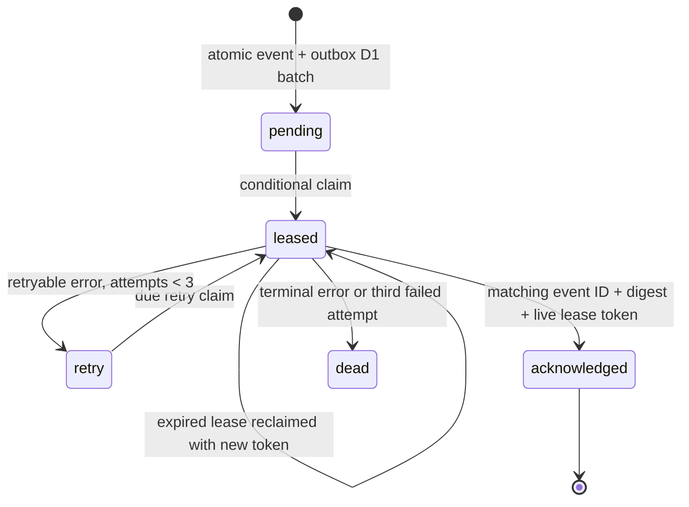

# G1B local transactional-outbox qualification (2026-11-26)

**Decision: `GCP_G1B_LOCAL_OUTBOX_PASS` for a synthetic-only local prototype.** This is not a production migration, Worker change, real gateway, Kafka test, or cloud qualification. `DEFER_SPARK_ENFORCED` and `DEFER_KFP` remain in force. No Cloudflare/GCP API or deployed D1 was changed.

## Source and isolation

The local `main` HEAD is `a195607d36df61141671345abcc1bf81712bc289`, ahead 8/behind 8 relative to the cached `origin/main` ref `09bdeaaeab532d3ebd59ee9199f3ee1a76cd1659`. The existing working tree had unpublished Cloudflare release changes and the G0/G1A documents before G1B. No reset, checkout, stash, pull, commit, push or PR was used. The only G1B files are the three isolated files in `deploy/cloudflare/prototypes/g1b-outbox/` and this report. The prototype reads the existing `deploy/cloudflare/migrations/0001_focus.sql` into a **disposable Miniflare D1**, then applies its separate `0001_outbox.sql` there. It does not edit the deployed Worker, the production migration, the Linux FastAPI/SQLite outbox, or any running service.

The G1A consistency design (unpublished, outside this focused PR) provides the intended boundary. The current Worker create path uses `db.batch()` and unique `event_id`/`idempotency_key`, owner and canonical replay verification. This prototype models those storage rules and the future delivery lifecycle; it is not an HTTP route implementation and does not claim the existing Worker is bridge-ready.

## Schema and state machine

`outbox.event_id` is the delivery ID and foreign key to the committed `events.event_id`. The existing event ID and idempotency key are unchanged on replay. The outbox stores the original synthetic event payload, SHA-256 digest, session sequence, owner, attempts, due time, lease token/expiry, acknowledgment time and inspectable error class. A unique `(session_id, sequence)` index and query gate prevent a later session event from dispatching before its predecessor is acknowledged. Dead-lettered predecessors deliberately block later events until an operator repair decision. No credential, cookie, personal data or real owner identifier is used in fixtures.

Claim is one conditional D1 `UPDATE ... RETURNING`, so two dispatchers cannot acquire the same live lease. Acknowledgment and failure updates require the current token and unexpired lease. Retry delay is deterministic `min(60, 2^attempts)` seconds, capped at three failed attempts for this prototype; production timing and dead-letter policy remain open. Identical `append` replay requires matching owner and IDs, canonical event fields excluding `ingested_at` (as in the Worker), and a matching outbox digest for the originally persisted JSON. A persisted event missing its matching outbox is an error, never a successful replay. Session creation, event insert and outbox insert share one D1 batch; later synthetic lifecycle appends also use the existing `cas_guard` pattern for contiguous sequence. Unknown database errors propagate.

## Local mock and failure matrix

The in-process `MockGateway` records a logical sink row keyed by event ID and rejects a changed digest. It also records every accepted attempt, so duplicate **delivery attempts** remain visible even though one logical sink record remains. The mock has no TLS, authentication, Kafka broker, replication, partitioning or durable remote acknowledgment; its Map is retained only by the test process. It is a deterministic failure injector, not a GCP ingestion gateway.

| Injected failure / sequence | Observed local result |
| --- | --- |
| Event/outbox batch fails after event insert | D1 batch rolls both back; event and outbox counts stay zero or at the prior committed value. |
| Identical append/replay, conflicting owner/payload/key, or missing outbox on replay | One event/outbox; identical replay returns existing identity; conflicts or incomplete persisted state fail. The existing Worker race test separately covers concurrent HTTP create. |
| Two simultaneous dispatcher claims | Exactly one live lease; second claim returns no row. |
| Gateway unavailable or timeout before ack | Retry row retains event ID/digest, due time and error class; after third failure it becomes inspectable `dead`. |
| Gateway accepts then ack is lost | Retry sends the same ID; mock records duplicate attempts and one logical sink row. |
| Crash immediately after lease | No sink write; expiration allows a new holder to deliver. |
| Crash after gateway accepts but before D1 success mark | New holder retries after expiry; duplicate attempt, one logical sink row. |
| Old holder acknowledges at/after expiry or after reclaim | Rejected; current delivery state is unchanged. |
| Later session event due before predecessor | Claim is blocked; after predecessor ack, events arrive in original sequence. |
| Dispatcher runtime restart with persistent local D1 | Retry row survives Miniflare disposal/recreation and converges when mock gateway recovers. |
| Wrong digest ack or explicit terminal schema failure | Wrong ack rejected; terminal row remains `dead` with error class and payload digest. |
| Reconciliation scan | Reports missing sink IDs, orphaned sink IDs, duplicate attempts, digest mismatches and unacknowledged rows separately. |

**Delivery claim:** D1 can retain a committed event until a later retry; the mock demonstrates at-least-once *attempts* and idempotent logical sink processing under the tested failures. A successful HTTP acknowledgment, Kafka durable commit and every downstream materialization are different boundaries. There is no end-to-end exactly-once guarantee.

## Executed checks and evidence

- `node prototypes/g1b-outbox/outbox.test.mjs` from `deploy/cloudflare`: **12 passed, 0 failed** against local Miniflare/workerd D1. Includes D1 atomic rollback, replay/conflict and missing-outbox rejection, concurrent claims, lease expiry, retry/dead letter, lost ack, both crash points, ordering, reconciliation and persisted D1 runtime restart. Miniflare required local loopback permission; the first sandbox attempt failed at `listen EPERM 127.0.0.1`, then the suite passed with local loopback available. No remote service was contacted.
- `node --test tests/d1-atomic.mjs tests/session-create-race.mjs`: **3 passed, 0 failed**, including the existing 30-group three-way session-create race and controlled conflict case. These tests exercise the unchanged Worker contract, not the prototype's deployment readiness.
- `node --check` on both new `.mjs` files: **pass**. `git diff --check`: **pass**. Separate check of G1B untracked files found no trailing whitespace or missing final newline.
- SHA-256: `0001_outbox.sql` `ee8938d5d475308fe7f01c886201b1caf0eb0d98d119411186c1cb4b953abc14`; `outbox.mjs` `3eafcfdb7c104159859de1643729062f1af842027858c1337bfab904efb73303`; `outbox.test.mjs` `fa016155677f48d56e8bc7e38748701709f131f1192d09eb5435a2d235f05b05`.

These are **local workerd/D1 results**, not cloud, real Kafka, secured gateway or measured Free-plan results. The test fixtures use fixed synthetic timestamps and IDs. The runtime-restart test uses a temporary persistent Miniflare directory and deletes it afterward. No credentials or real personal data were introduced.

## Remaining design assumptions and next qualification

The prototype uses Node `crypto`, an in-process gateway and no network transport; it is deliberately outside the deployed TypeScript Worker bundle. Production integration needs an additive D1 migration plan, bounded input/schema validation, explicit event subset and backfill policy, safe secret management and authenticated HTTPS gateway, durable Kafka-side dedup/ack semantics, partition/replication and consumer replay tests, D1 row/CPU budget, Cron/Free-plan CPU measurement, privacy and retention review, and rollback without altering current owner sessions. SQLite-style behavior alone is insufficient; these tests used local workerd D1, but live D1 concurrency and operational limits still require separate qualification.

The smallest next step is an **authorized, isolated Worker-compatible dispatcher adapter and secured mock-HTTP gateway test** using this state machine, with Cloudflare Free CPU/D1-operation measurements. That step must not apply this migration to production or connect to real Kafka without separate approval. G1B stops here.
