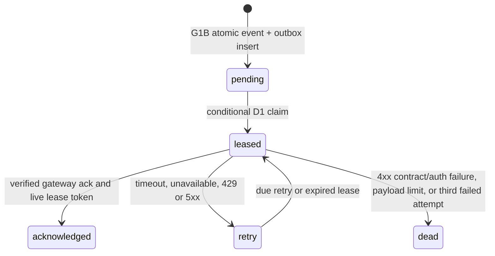

# G1B.2 Worker dispatcher and secured local gateway qualification (2026-11-26)

**Decision: `GCP_G1B2_LOCAL_GATEWAY_PASS` for an isolated, synthetic-only local prototype.** This does not qualify a production bridge, real Kafka, GCP, public gateway, or Cloudflare Workers Free CPU. Cloudflare V0.1, its D1 database, DNS, credentials and logging configuration were untouched. `DEFER_SPARK_ENFORCED` and `DEFER_KFP` remain in force.

## Revision, isolation and implementation

Local `main` HEAD is `a195607d36df61141671345abcc1bf81712bc289`, ahead 8/behind 8 relative to cached `origin/main` `09bdeaaeab532d3ebd59ee9199f3ee1a76cd1659`. The checkout already contained unpublished Cloudflare release edits/deletions and G0/G1A/G1B evidence. G1B.2 added only `deploy/cloudflare/prototypes/g1b2-gateway/{dispatcher,gateway,harness,gateway.test}.mjs` and this report. No reset, stash, checkout, pull, commit, push or PR occurred. The sibling G1B prototype and production migration/source were left intact.

The local test harness loads the unchanged `0001_focus.sql` plus the **test-only** G1B `0001_outbox.sql` into disposable Miniflare/workerd D1. The dispatcher module uses Worker-supported `crypto.subtle`, `fetch`, `AbortController`, `performance`, `TextEncoder` and D1 prepared statements; it imports no Node modules. `harness.mjs` exposes a **test-only** `/dispatch` hook to execute it inside workerd. That hook is not a public API and must never be deployed. The gateway simulator uses Node HTTP on `127.0.0.1` with an ephemeral port, a synthetic per-test HMAC secret and a deterministic in-memory sink. It has no real Kafka connection.

## State and HTTP protocol

Each claim is a conditional D1 `UPDATE ... RETURNING` with a new UUID lease token and 10-second lease. The token fences acknowledgments and failures from a stale holder; updates also check that the lease is unexpired at update time. A later event for the same session is not claimed until all lower sequences are acknowledged. A dead predecessor blocks the session until repair. Retries keep the original `event_id`, payload and SHA-256 digest, with `min(60, 2^attempts)` seconds of deterministic backoff and a three-failure dead-letter threshold. The dispatcher caps a run at **5 items and 8,192 payload bytes** (defaults: 1 item, 4,096 bytes), stops on a failure, and releases a claimed row without consuming an attempt if the remaining batch byte budget is insufficient. Oversized first rows become inspectable dead letters. `inspectDead()` and `reconcile()` are bounded to 100 rows/IDs; reconciliation flags truncated pages so uninspected accepted IDs are not falsely called orphaned. D1 call counts returned by the dispatcher count its explicit query calls, not billable rows read/written.

For each item, the Worker sends one JSON `POST /ingest` with stable event/session IDs, sequence, persisted payload and digest. Headers carry synthetic key ID, timestamp, random nonce and HMAC-SHA256 over `timestamp + newline + nonce + newline + exact body`. The local gateway verifies signature with `timingSafeEqual`, a ±30-second window, a nonce cache, exact body fields, payload digest and event schema identity. It caps the HTTP body at 8,192 bytes, the payload at 4,096 bytes and requests per test server at a configured count. It rejects unsigned/bad signatures, stale/replayed nonces, malformed payloads and conflicting bytes under an existing event ID. It retains one logical sink row per event ID while recording repeated accepted attempts. It returns event ID plus digest only after local sink acceptance. No secret, header or payload is logged by the prototype.

The gateway uses **plain HTTP only on loopback** for testing. A future cloud gateway requires TLS, durable replay defense and deduplication, controlled public ingress, service identity, rate limiting, rotation and privacy review. The local nonce cache and sink are not durable across gateway restart. `401`/`403` are terminal in the local policy; `429` and network/timeouts are retryable. This policy needs review against real gateway error contracts before any integration.

## Fault-injection results

| Case | Local observation |
| --- | --- |
| Successful 2-item batch | Two stable IDs acknowledged; four explicit D1 calls and two HTTP requests. |
| Ack lost after sink acceptance | Same ID retried; two accepted attempts, one logical sink row. |
| Timeout before response; gateway unavailable | Outbox stays retryable with bounded attempt count; no silent acknowledgment. |
| Crash after lease; crash after gateway acceptance before D1 mark | Expired lease recovers; accepted duplicate is deduplicated by sink. |
| Expired lease and stale holder | New dispatcher claims; stale token cannot update the row. |
| Out-of-order retry | Later session sequence waits for predecessor acknowledgment. |
| Gateway `401`/`403` | Terminal inspectable dead-letter state. |
| Gateway `429`, request cap | Retryable backpressure; third failed attempt becomes dead letter. |
| Invalid signature, unsigned request, nonce replay, stale timestamp, malformed schema, oversized body | Rejected with safe status; no extra sink row. |
| Conflicting payload under same event ID | Rejected; prior logical sink row preserved. |
| Concurrent dispatchers | One live lease and one sink row for the same event. |
| Cancellation before claim | No row claimed or changed. |
| Runtime restart | Persisted local D1 retry state and retained mock sink converge after replay. |
| Reconciliation | Missing, orphaned, duplicate-attempt and unacknowledged IDs reported separately. |

These tests demonstrate **at-least-once attempts plus idempotent mock sink processing**, not end-to-end exactly-once delivery. The mock sink's acknowledgment is not a Kafka durable producer ack, and no downstream Flink/Delta consumer was run.

## Executed verification and local resource evidence

- `node --test prototypes/g1b2-gateway/gateway.test.mjs prototypes/g1b-outbox/outbox.test.mjs tests/d1-atomic.mjs tests/session-create-race.mjs`, from `deploy/cloudflare`: **31 passed, 0 failed** (16 new gateway/dispatcher, 12 G1B, 3 existing D1/concurrency). Miniflare needed local loopback permission; no public listener or cloud API was used.
- `.venv/bin/pytest deploy/cloudflare/tests/test_security.py -q`: **3 passed**, one existing Starlette deprecation warning. The first sandbox-only attempt stalled without output and was interrupted; the authorized local-loopback run completed. This checks the existing Python adapter security, not future gateway production security.
- `node --check` on all four new `.mjs` files: **pass**. `esbuild` bundled the test harness and dispatcher for browser/Worker platform without Node imports: **pass**. TypeScript compiler was not installed at `deploy/cloudflare/node_modules/.bin/tsc`; no TypeScript source changed. `git diff --check`, separate whitespace/final-newline check for untracked files and obvious credential-marker scan: **pass**.
- In the final combined workerd run, **30 repeated single-event dispatches** all succeeded: payloads **384–386 bytes**, one HTTP request and **two explicit D1 calls** (claim, ack) per successful delivery, zero retries/failures in this measurement phase. Worker-side `performance.now()` **wall-time** median **6 ms**, p95 **10 ms**, max **11 ms**; host-side end-to-end max **18.75 ms**. Node host RSS increased **9,650,176 bytes** during the loop, including Miniflare, test harness and Node gateway; this is not Worker-isolate memory. Other local runs varied (for example 30-sample Worker wall median 6 ms, p95 9 ms, max 10 ms). No trustworthy per-invocation **Worker CPU** counter was exposed by this local path, so CPU median/p95/max are **unmeasured**. Wall time must not be compared numerically with the 10 ms CPU limit.

Source SHA-256: `dispatcher.mjs` `0e28c395087971d273743e8cc49ffba93828a4b1a14d5c8e553962476843fec8`; `gateway.mjs` `2bf65a003820e6cbaf75e22198e3061bd3ceab87578c5514d97b2dc610a9fb48`; `harness.mjs` `1293b9f61d1f922e454bbabc73fd972cca0bb8d1f539de4bc13a9017eddac07f`; `gateway.test.mjs` `a315bfe31c8878eb2ec9d893a0f2173118ec59d5f7d8775a87077d3c4c4ac4cd`.

## Cloudflare Free assessment and next gate

Current official [Workers limits](https://developers.cloudflare.com/workers/platform/limits/) list **10 ms CPU per Free HTTP/Cron invocation**, 100,000 requests/day, 128 MB memory and 50 subrequests/invocation. [D1 limits](https://developers.cloudflare.com/d1/platform/limits/) include 50 queries per Free Worker invocation and 500 MB per database; [D1 pricing](https://developers.cloudflare.com/d1/platform/pricing/) lists 5 million rows read/day and 100,000 rows written/day on Free. D1 reads/writes and HMAC work can consume Worker CPU; query-call counts are not row-billing counts. The local data supports **one event per invocation as the smallest candidate batch** for a future live CPU test. It does **not** establish Free-plan CPU headroom, daily quota fit or billable usage. A larger batch or a high retry rate needs separate measurement and may exceed Free limits.

Remaining requirements: additive production-safe outbox migration and backfill decision; owner-approved event subset and data minimization; Worker scheduler integration with no public test hook; authenticated HTTPS gateway with durable nonce/dedup records and Kafka durable-ack policy; gateway IAM/network controls, rotation and privacy retention; actual D1 row and Worker CPU measurements; bounded reconciliation across pagination; live resource-limit/error monitoring; and rollback preserving the current Worker/D1. The **next gate** is a separately authorized isolated preview or other supported per-invocation CPU qualification using one synthetic event per dispatch, after the security and migration design are reviewed. No production publication follows from G1B.2.
